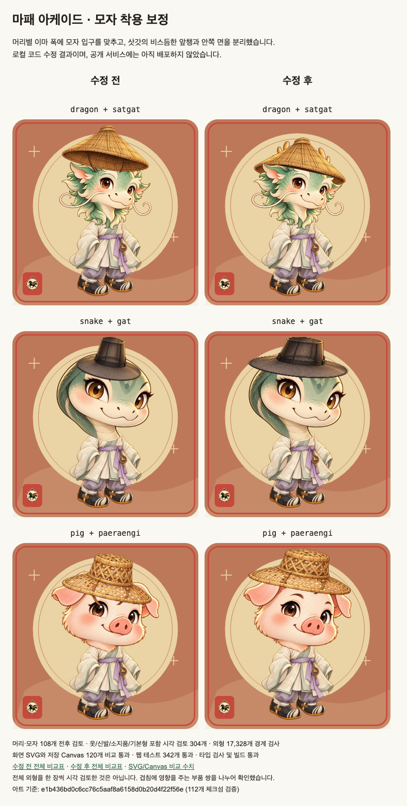

# Mapae Arcade assets

Mapae Arcade에서 사용하는 이미지 113개와 캐릭터 착용 메타데이터를 메인 [Mapae 저장소](https://github.com/kooroot/Mapae)와 분리해 관리합니다. `arcade/` 아래의 경로는 `apps/web/public/arcade/`의 경로와 같습니다. `previews/`는 검토용 이미지이며 웹 배포 대상에 포함하지 않습니다.

메인 저장소를 빌드하거나 배포하기 전에 에셋을 복사하세요. 예를 들어 두 저장소가 같은 상위 디렉터리에 있다면:

```bash
cd Mapae-arcade-asset
shasum -a 256 -c SHA256SUMS
mkdir -p ../Mapae/apps/web/public/arcade
rsync -a arcade/ ../Mapae/apps/web/public/arcade/
test -f ../Mapae/apps/web/public/arcade/lobby-scene.webp
test -f ../Mapae/apps/web/public/arcade/wardrobe/fit.json
```

업데이트할 때는 이 저장소에서 `git pull --ff-only origin main`을 실행한 다음 검증과 복사를 반복합니다. `.git` 디렉터리를 웹의 `public/` 아래로 복사하지 마세요.

메인 저장소의 CI는 `.github/workflows/ci.yml`에서 에셋 커밋을 고정합니다. 새 에셋을 사용하려면 해당 `ref`도 갱신해야 합니다. `SHA256SUMS`는 이미지 113개와 아래 착용 메타데이터를 함께 검증합니다.

## 2026-10-10 흥정상회 엽전

흥정상회 거래 연출에 쓰는 엽전 스프라이트 `arcade/coin-yeopjeon-512.webp`(512 × 512, 알파 포함)를 추가했습니다. 조선 상평통보(常平通寶)를 본뜬 놋쇠 동전으로, 네모 구멍 둘레에 常·平·通·寶가 위·아래·오른쪽·왼쪽 순서로 돋을새김되어 있고 구멍을 지나는 붉은 매듭끈이 위로 이어집니다. 화면을 가로질러 날아가는 용도이므로 32~48px에서도 둥근 테두리와 네모 구멍이 읽히도록 윤곽을 굵게 했습니다. 이미지는 imagegen이 아니라 손으로 작성한 SVG를 헤드리스 Chromium으로 래스터화해 만들었습니다.

## 2026-10-09 캐릭터 모자 착용 보정

이번 변경은 원본 WebP를 다시 그린 것이 아니라, 머리와 모자를 합성하는 좌표를 보정한 것입니다. [wardrobe/fit.json](arcade/wardrobe/fit.json)에 12종의 머리 기준점과 8종 모자의 입구·앞챙 데이터를 저장합니다. 메인 앱의 `guardian-layers.ts`가 이 파일을 빌드 시 읽으며, 화면 SVG와 저장용 Canvas가 같은 결과를 사용합니다. 이 데이터를 적용하려면 앱 렌더러가 아래 합성 규칙과 다각형 클리핑을 지원해야 합니다.

- 용의 삿갓은 비스듬한 앞챙을 머리 앞에, 안쪽 면과 끈을 머리 뒤에 배치합니다.
- 뱀처럼 이마가 높고 넓은 머리는 모자 높이를 줄이더라도 입구 너비를 유지합니다.
- 돼지 등에서 눈썹을 덮던 모자는 머리별 이마 위치와 폭에 맞춥니다.

### 데이터와 합성 규칙

`heads[zodiac]`의 `x`, `y`, `width`는 400 × 400 캐릭터 캔버스에서 이마 중심과 폭을 나타냅니다. 귀·뿔·갈기·볏은 입구 폭에 포함하지 않습니다. 기준 머리 이미지는 `{x: 84, y: 47, width: 232, height: 190}` 상자 안에 비율을 유지하고 아래쪽 중앙에 맞춰 배치합니다.

`hats[hat]`의 `ratio`는 원본 높이/너비, `opening`은 원본 이미지 기준 0~1 좌표의 입구 중심과 폭입니다. 모자 상자는 다음처럼 계산합니다.

```text
width  = head.width / hat.opening.width
height = min(width * hat.ratio, (head.y - 12) / hat.opening.y)
x      = head.x - width  * hat.opening.x
y      = head.y - height * hat.opening.y
```

모자 이미지는 계산한 상자를 채워 그립니다. 높이를 제한할 때 너비까지 함께 축소하지 않습니다. `front`가 있으면 전체 모자를 머리 뒤에 그린 뒤, 머리 앞에는 `front`의 `{x, y}` 정점들을 모자 상자 좌표로 변환한 다각형 안쪽만 한 번 더 그립니다. `front`가 없으면 모자 전체를 머리 앞에 그립니다. 모자 없음은 합성 레이어를 추가하지 않습니다.

### 검토 결과

머리 12종 × 모자 옵션 9개(미착용 포함), 총 108개를 전후 비교했습니다. 옷·신발·소지품·기본형까지 부품 간 겹침을 나눠 304개 사례를 시각 검토했고, 17,328개 외형 조합의 레이어 경계와 클립 좌표를 자동 검사했습니다. 전체 외형을 각각 시각 검토한 것은 아닙니다. SVG와 Canvas 출력 비교 120개, 웹 테스트 342개, TypeScript 검사와 웹 빌드도 통과했습니다.



108개 모자 조합의 수정 후 비교표: [쥐](previews/guardian-fit/hats-rat.png) · [소](previews/guardian-fit/hats-ox.png) · [호랑이](previews/guardian-fit/hats-tiger.png) · [토끼](previews/guardian-fit/hats-rabbit.png) · [용](previews/guardian-fit/hats-dragon.png) · [뱀](previews/guardian-fit/hats-snake.png) · [말](previews/guardian-fit/hats-horse.png) · [양](previews/guardian-fit/hats-goat.png) · [원숭이](previews/guardian-fit/hats-monkey.png) · [닭](previews/guardian-fit/hats-rooster.png) · [개](previews/guardian-fit/hats-dog.png) · [돼지](previews/guardian-fit/hats-pig.png).

## 2026-10-03 게임 그래픽

코스·장터·야시장 배경 3종과 갑옷·대장 도깨비 2종을 추가했습니다. 기존 캐릭터를 유지하며 새 장면은 게임 렌더러가 캐릭터와 UI를 별도로 합성합니다. 새 WebP 5종은 약 779 KiB이며 모자이크나 게임 화면을 통째로 그린 이미지가 아닙니다. 이미지는 imagegen으로 제작했습니다.
